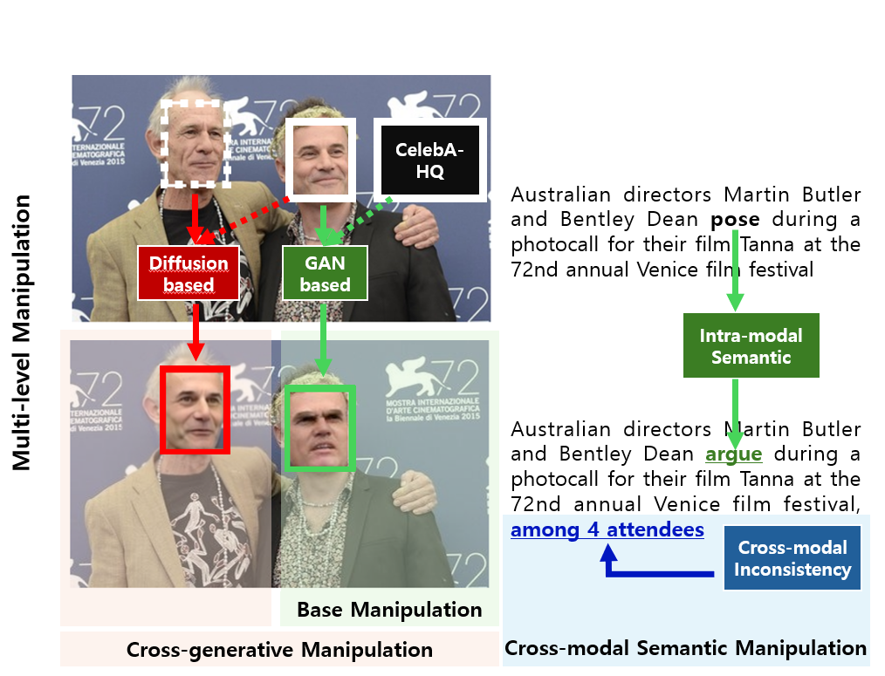

# DGM4-Complex

**A multi-level multimodal manipulation benchmark for deepfake detection, grounding, and cross-modal reasoning.**

> Companion dataset to
> *GraDual: Resolving the Semantic–Frequency Trade-off via Gradient-Regulated Dual-Branch Multimodal Manipulation Detection*
> (IEEE Access 2026, under review).
>
> **This repository is a review-grade preview.** It ships the full
> metadata schema, reproduction scripts, a curated sample set, and
> review figures. The complete dataset (≈ 37 GB, 276,931 samples)
> is hosted externally — see
> [`docs/full_dataset_access.md`](docs/full_dataset_access.md).

---



## What's in this repository

```
dgm4-complex/
├── README.md
├── figures/               review figures used in the paper / README
├── samples/               27 curated samples + sample_metadata.json
├── scripts/
│   ├── verify_statistics.py   reproduces paper Table 3 / Table 4
│   ├── extract_samples.py     rebuilds samples/ from full metadata
│   └── make_figures.py        regenerates figures/ from samples/
└── docs/
    ├── metadata_schema.md
    └── full_dataset_access.md
```

## Reproducing paper statistics

```bash
export DGM4_COMPLEX_META=/path/to/DGM4_extended/metadata
python scripts/verify_statistics.py
```

Expected tail of output:

```
[2/3] Paper Table 3 — total samples
  ✓ Total samples           276,931  (paper:  276,931)

[3/3] Paper Table 4 — auxiliary occurrences
  ✓ FAM                      46,931  (paper:   46,931)  (16.95%)
  ✓ TAM                      32,553  (paper:   32,553)  (11.75%)
  ✓ NT                       22,155  (paper:   22,155)  ( 8.00%)
  ✓ NT_CTRL                  13,847  (paper:   13,847)  ( 5.00%)

All checks passed.
```

## Citation

```bibtex
@article{lee2026gradual,
  title   = {GraDual: Resolving the Semantic--Frequency Trade-off via
             Gradient-Regulated Dual-Branch Multimodal Manipulation Detection},
  author  = {Lee, Donghun and Choi, Jang-Ho and Kim, Seongho and
             Yi, Sungwon and Kwak, Nojun},
  journal = {IEEE Access},
  year    = {2026},
  note    = {Under review}
}

@inproceedings{shao2023dgm4,
  title     = {Detecting and Grounding Multi-Modal Media Manipulation},
  author    = {Shao, Rui and Wu, Tianxing and Liu, Ziwei},
  booktitle = {CVPR},
  year      = {2023}
}
```

## License and access

- **Code**: Apache-2.0.
- **Dataset**: research use only, inheriting the non-commercial terms of
  the upstream DGM4 and Visual News releases.
- **Base DGM4 face manipulations** are **not** redistributed here.
  Obtain them from
  [MultiModal-DeepFake](https://github.com/rshaojimmy/MultiModal-DeepFake);
  our metadata references those files by path.

See [`docs/full_dataset_access.md`](docs/full_dataset_access.md) for
interim access during the review period and planned mirrors after
acceptance.
